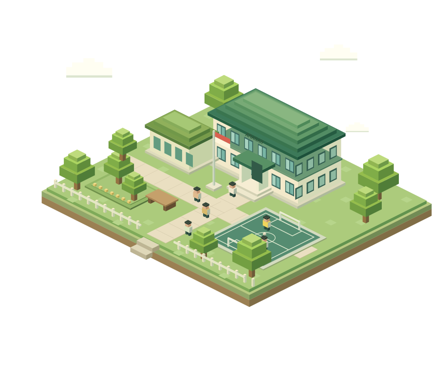

<p align="center">
  
</p>

# Sekolah Amanah

Website Sekolah Amanah untuk jenjang KB/RA–TK, SD, SMP, dan SMK, dengan ilustrasi sekolah 3D bergaya pixel, profil setiap jenjang, serta akses layanan sekolah.

**[Buka website](https://sekolah-amanah.wasmer.app/)** · **[Sumber konten](https://sekolahamanah.sch.id/)**

<p align="center">
  
</p>

## Fitur

- Ilustrasi sekolah 3D yang berputar otomatis, dengan kontrol jeda dan mode pencahayaan.
- Alex dan Steve mengintip di atas banner sambil melambaikan tangan dalam 3D, dengan gambar cadangan saat WebGL tidak tersedia.
- Adegan mini portal di atas garis slogan: Alex dan Steve berlari, lalu Steve berhenti untuk dadah sebelum masuk portal. Animasi mengulang dan mengikuti pengaturan jeda.

- Empat profil sekolah dengan program belajar, dokumentasi kegiatan, dan lokasi cabang.
- Banner penerimaan murid baru 2027 yang langsung menuju formulir pendaftaran.
- Berita kegiatan dan prestasi dengan pencarian, filter, dan detail artikel.
- Peta sekolah serta tautan Instagram SD, SMP, dan SMK.
- Akses cepat Pijar Sekolah dan layanan surat SMK Amanah.
- Tampilan responsif, navigasi keyboard, serta dukungan reduced motion.

## Teknologi

Model karakter memakai geometri dan tekstur asli dari file Blender yang diberikan pengguna. Catatan konversi tersedia di [assets/models/README.md](assets/models/README.md).

HTML, CSS, JavaScript, dan Three.js r128. Hosting menggunakan Wasmer Edge dengan Static Web Server. Halaman dan aset utama disimpan lokal; proyek tidak memerlukan instalasi dependency atau proses bundling.

## Menjalankan secara lokal

Gunakan Node.js 22 atau versi yang kompatibel.

```sh
git clone https://github.com/alghi711/sekolah-amanah.git
cd sekolah-amanah
npm start
```

Buka `http://localhost:4173`. Untuk pemeriksaan otomatis:

```sh
npm test
```

## Mengubah konten

| File | Kegunaan |
| --- | --- |
| `index.html` | Beranda, banner, layanan, media sosial, dan footer |
| `make-profiles.cjs` | Data dan template empat profil sekolah |
| `content.js` | Snapshot berita dari website utama |
| `pixel-reference.css` | Gaya utama website |
| `profiles.css` | Tampilan halaman profil |
| `campus.js` | Model 3D dan animasi sekolah |
| `PROFILE-SOURCES.md` | Catatan sumber konten dan media sosial |

Setelah mengubah data atau template profil, jalankan `node make-profiles.cjs` untuk menghasilkan ulang empat halaman profil.

Konten berita merupakan snapshot; pembaruan dari website sumber tidak berjalan otomatis. `import-content.ps1` digunakan untuk mengambil ulang konten dan menimpa snapshot beserta aset terkait.

## Deploy ke Wasmer

Setelah Wasmer CLI terpasang dan akun sudah login:

```sh
node make-profiles.cjs
node check.cjs
node prepare-deploy.cjs
wasmer deploy --non-interactive
```

`prepare-deploy.cjs` menyalin lima halaman dan aset publik ke `dist/`. Konfigurasi hosting ada di `app.yaml`, `wasmer.toml`, dan `settings/config.toml`. Folder `dist/` tidak disimpan di Git. Untuk deploy pada akun lain, sesuaikan pemilik dan identitas aplikasi di `app.yaml` terlebih dahulu.

## Sumber dan aset

Foto, identitas sekolah, alamat, dan berita berasal dari [website Sekolah Amanah](https://sekolahamanah.sch.id/). Ilustrasi 3D bersifat imajinatif, bukan denah atau representasi fasilitas yang dijanjikan. Catatan perubahan poster tersedia di `assets/SPMB-2027-NOTES.md`.

Font memakai SIL Open Font License dan Three.js memakai MIT License. Berkas lisensi masing-masing disertakan di folder `assets/`.

---

Tim IT Amanah · 2026
